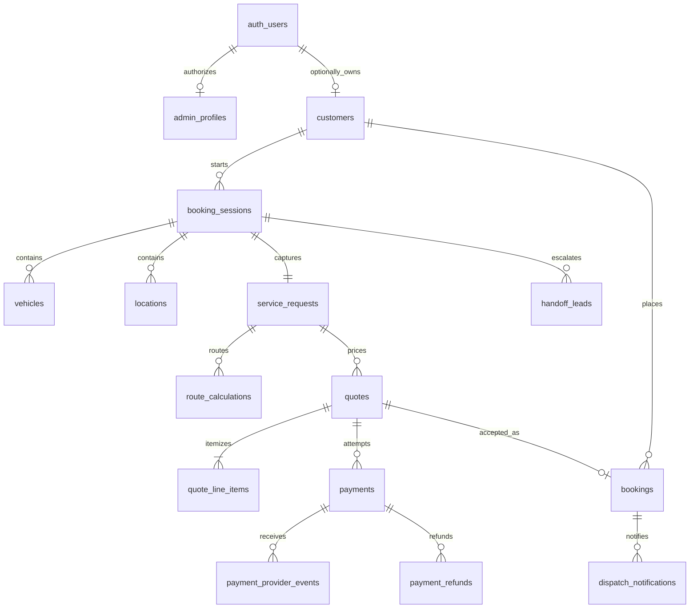

# Roadside Quote database

## Design goals

The schema supports guest-first roadside quote sessions while keeping all customer, booking, payment, and dispatch data behind trusted server code or explicit administrator roles. PostgreSQL constraints—not browser state—enforce relationship integrity and financial invariants.

All primary keys are UUIDs. All timestamps are `timestamptz` and are stored by PostgreSQL as UTC instants. Address rows retain an explicit validated IANA timezone for local service-hour and pricing decisions.

## Relationship overview



## Tables

| Table                     | Purpose and important invariants                                                                                                                              |
| ------------------------- | ------------------------------------------------------------------------------------------------------------------------------------------------------------- |
| `customers`               | Verified E.164 phone, name, optional Auth owner, and explicit SMS consent timestamp. A customer row is created only after phone verification.                 |
| `booking_sessions`        | Current screen/progress, request type, expiry, optional Auth owner, and a unique SHA-256 access-token hash. Raw guest tokens are never stored.                |
| `vehicles`                | Session/customer vehicle with constrained year and heavy-duty classification.                                                                                 |
| `locations`               | One pickup and one drop-off per session, Google Place ID, coordinates, confirmation state, and validated IANA timezone.                                       |
| `service_requests`        | One request per session with same-session vehicle/location composite foreign keys, structured answers, notes, and special flags.                              |
| `route_calculations`      | Immutable Google route result. Pickup/drop-off must exactly match the service request. Meters, raw miles, billable miles, and provider metadata are retained. |
| `pricing_parameters`      | Versioned/effective numeric parameters. Only one version per key can be active. Monetary values must be whole cents.                                          |
| `quotes`                  | Immutable route/pricing/monetary snapshot, integer subtotal/tax/total, ISO currency, validity, and controlled status lifecycle.                               |
| `quote_line_items`        | Immutable normalized line-item snapshot. Deferred constraints require line totals to equal the quote subtotal.                                                |
| `payments`                | Provider references and integer amounts only. Amount/currency must match an accepted, unexpired quote. Request identity and idempotency key are immutable.    |
| `payment_provider_events` | Append-only webhook/event ledger with globally unique provider event IDs and payload hashes.                                                                  |
| `payment_refunds`         | Idempotent provider refunds. Successful refund totals are locked/reconciled and cannot exceed the payment amount.                                             |
| `bookings`                | Unique public reference tying one customer/session/request/quote/payment relationship together. Cross-record consistency is trigger-enforced.                 |
| `handoff_leads`           | Server-collected escalation details, reason, assigned team, callback queue state, and resolution timestamp.                                                   |
| `dispatch_notifications`  | Retryable outbox. Idempotency key and semantic event identity are both unique; request identity is immutable.                                                 |
| `audit_logs`              | Append-only changes to administrators, pricing, settings, payments, bookings, handoffs, and dispatch records.                                                 |
| `admin_profiles`          | Supabase Auth user mapped to one authorized application role. Disabled profiles immediately lose policy access.                                               |
| `application_settings`    | Company/support/dispatch defaults and configurable customer messages by scope.                                                                                |

No table contains card number, PAN, CVV/CVC, expiration date, or bank credentials. Stripe-hosted payment collection must remain the card-data boundary.

## Quote and pricing immutability

A quote is assembled in `draft` state in one transaction:

1. Insert the quote with integer cents and a complete `pricing_snapshot` JSON object.
2. Insert normalized `quote_line_items`.
3. Move the quote to `offered`.
4. Commit; the deferred subtotal trigger verifies line items equal `subtotal_cents`.

After insertion, route calculations, quote monetary fields, pricing snapshot, validity, and line items cannot be changed. The snapshot must include every pricing parameter, value, unit, and version used by the server calculator. A new calculation creates a new quote; it never edits a historical quote.

Only `offered` quotes can become `accepted`, and acceptance must occur before `valid_until`. Payments require an accepted, unexpired quote and exact amount/currency equality.

## Idempotency

### Payments

Call the service-role-only `create_payment_attempt(quote_id, key, fingerprint)` function. The fingerprint is a SHA-256 hash of a canonical request representation.

- New key: creates one pending payment using the trusted quote amount/currency.
- Same key + same quote/fingerprint: returns the original payment.
- Same key + different request: raises a conflict.
- A partial unique index permits only one active payment attempt per quote.

Signed provider events must first call `record_payment_provider_event(...)`. Matching event replays return the existing event; conflicting content with the same provider event ID is rejected.

### Dispatch

Call `enqueue_dispatch_notification(...)`. A retry with the same key and event identity returns the existing outbox row. Conflicting key reuse is rejected. `(booking, event, channel, recipient)` is also unique, preventing a caller from bypassing deduplication by generating a new key.

## Row Level Security

RLS is enabled and forced on every application table. `anon` has no table grants and no policies.

Ordinary authenticated customers also receive no direct customer, session, quote, booking, or payment rows. Customer operations must pass through server endpoints that validate the opaque HttpOnly session token, hash it, load an unexpired session through `bookingSessionRepository.js`, validate request input, and return a shaped response.

| Role                     | Direct database access                                                                         |
| ------------------------ | ---------------------------------------------------------------------------------------------- |
| `super_admin`            | Full operational administration; can manage admin profiles, pricing, and settings.             |
| `operations_admin`       | Operational records, bookings, pricing/settings, finance read, and audit read.                 |
| `dispatcher`             | Read operational context; manage booking dispatch and notification state.                      |
| `finance`                | Read payment/refund/provider-event records and general operational context; no payment writes. |
| `support`                | Read operational context and manage handoff leads.                                             |
| ordinary `authenticated` | No application rows unless an active `admin_profiles` row authorizes the user.                 |
| `anon`                   | No application table access.                                                                   |
| `service_role`           | Trusted backend workflows only; bypasses RLS and must never reach browser code.                |

Payment/refund writes and the three idempotent RPCs are service-role-only. Frontend route protection is not a substitute for these policies.

## Supabase clients

- `src/lib/supabase/client.js`: browser client with public URL/anon key. RLS always applies.
- `src/lib/supabase/server.js`: cookie-aware authenticated server client using the anon key.
- `src/lib/supabase/middleware.js`: current `@supabase/ssr` cookie refresh helper; wire it into root middleware when Auth routes are implemented.
- `src/lib/supabase/admin.js`: server-only service-role client for trusted repositories.
- `src/features/booking/repositories/bookingSessionRepository.js`: hashes 256-bit opaque guest tokens and performs narrowly shaped active-session lookup.

The service-role key is validated separately and is never required by browser/authenticated session clients.

## Migrations

| Migration                                          | Responsibility                                                                      |
| -------------------------------------------------- | ----------------------------------------------------------------------------------- |
| `20261102000100_database_foundation.sql`           | Extensions, enums, timestamp/timezone/reference helpers.                            |
| `20261102000200_roadside_schema.sql`               | Tables, foreign keys, checks, and indexes.                                          |
| `20261102000300_security_and_invariants.sql`       | Baseline triggers, auditing, RLS, and grants.                                       |
| `20261102000400_workflow_hardening.sql`            | Lifecycle rules, replay ledgers, atomic idempotency RPCs, and role-scoped policies. |
| `20261102000500_concurrency_and_authorization.sql` | Concurrent retry recovery, durable outbox rules, and dispatcher write restrictions. |

Never edit an applied migration. Add a new timestamped migration and test the upgrade from a production-like backup.

## Local database workflow

Docker Desktop must be running.

```bash
npm run db:start
npm run db:reset
npm run db:lint
npm run db:test
```

`db:reset` applies every migration and `supabase/seed.sql`. Seed pricing and contact details are examples for local development only and must not be promoted as production pricing.

The pgTAP suites cover:

- required schema and integer-money columns;
- absence of card-data columns;
- RLS on every application table;
- no anonymous policies or customer enumeration;
- administrator access;
- quote/payment/refund invariants;
- matching and conflicting payment/provider/dispatch retries;
- audit creation.

## Production checklist

1. Create the first Supabase Auth administrator through a controlled operator process.
2. Insert its `admin_profiles` row with the service role; browser users cannot bootstrap roles.
3. Replace seed company details and pricing through reviewed migrations or an authenticated admin service.
4. Restrict service-role and database credentials to server deployment secrets.
5. Verify Stripe webhook signatures before recording provider events.
6. Apply request rate limits and correlation IDs at the API layer.
7. Define backup, point-in-time recovery, audit retention, expired-session cleanup, and privacy deletion policies.
8. Run `supabase db reset`, `supabase db lint`, and `supabase test db` in CI with Docker before deployment.
